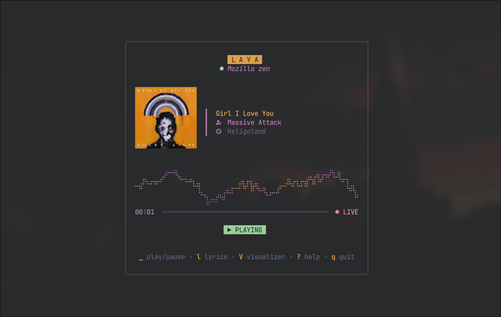
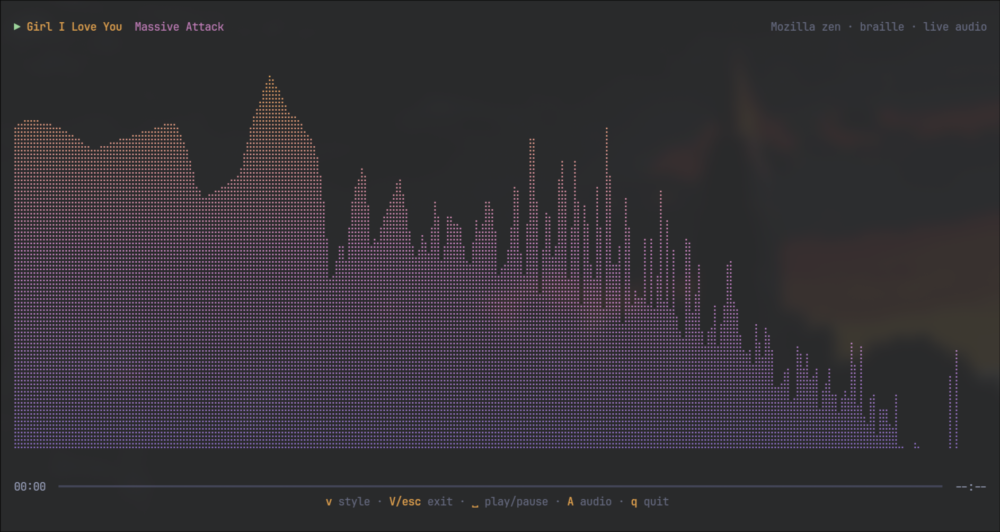
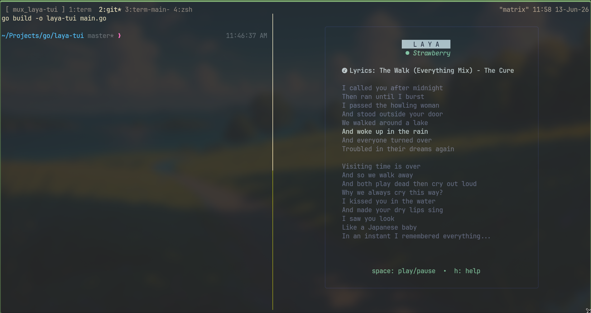
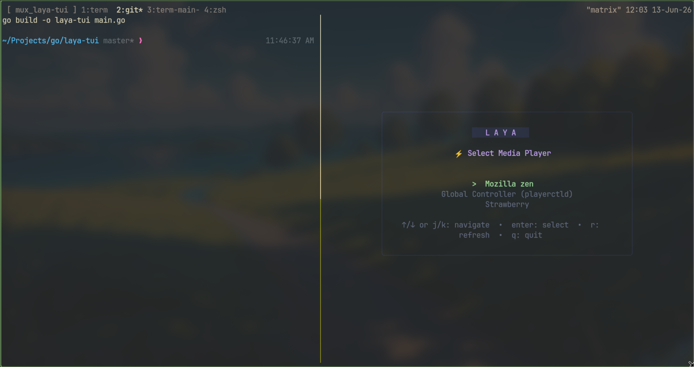
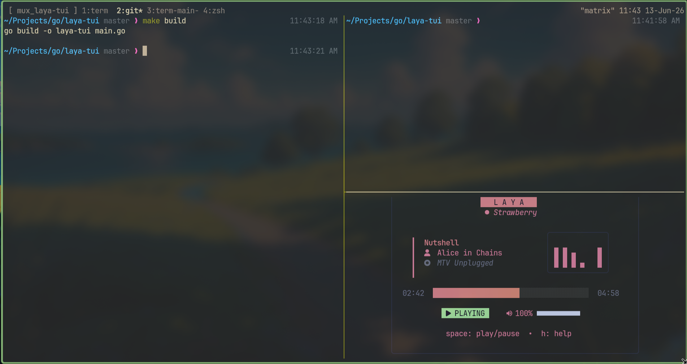

# LAYA

LAYA is a terminal-based MPRIS media controller and "now playing" dashboard for Linux. Built in Go using Bubble Tea, it talks to running players (`mpv`, `spotify`, `tauon`, `firefox`, `vlc`, …) over the D-Bus session bus.

## Preview

### Now playing — album art & live spectrum


### Fullscreen visualizer (`V`)


### Synced Lyrics & Player Selection
| Synced Lyrics | Player Selection |
| --- | --- |
|  |  |

### Mini Player (Responsive Layout)


## Features

- **Audio-reactive visualizer**: reads what your speakers are playing (the PipeWire/PulseAudio monitor, via `parec` or `pw-record`), runs an FFT, and draws a live spectrum with auto-gain and falling peak caps. Four styles (`v`): **bars**, **mirror**, **scope** (oscilloscope) and **braille**. `V` opens a fullscreen visualizer with the track, progress and the current lyric line. Audio is analysed in memory only and never saved; it falls back to a synthetic animation if capture isn't available or is disabled with `--no-audio` / `A`.
- **Album art**: shown next to the track. kitty and Ghostty get the real image through the kitty graphics protocol; other terminals get true-colour half-block art. Supports `file://`, `http(s)://` and `data:` art URLs.
- **Instant updates**: listens to MPRIS D-Bus signals, so play/pause, track changes and players appearing or quitting show up immediately (with a 1 s poll as a fallback). D-Bus calls run in the background with a timeout, so a frozen player can't freeze the UI.
- **Adaptive themes**: extracts accent colours from the album art (`mpris:artUrl`) with K-means clustering and re-themes the whole UI. Tracks without art fall back to the default Catppuccin palette.
- **Karaoke lyrics**: the highlight sweeps across the current line as it's sung.
- **Synced lyrics**: reads a sidecar `.lrc` next to local tracks, then falls back to [LRCLIB](https://lrclib.net/). Results (and misses) are cached in `~/.cache/laya/lyrics/`, so lyrics work offline and for streaming players such as Spotify. Browser/YouTube titles like `Song (Official Video)` are cleaned up before searching. Long lines wrap, and timing can be nudged per song with `<` / `>`.
- **Full transport control**: seek by ±5 s and ±30 s, jump to any 10 % mark, click the progress bar to seek, adjust volume or mute, and toggle shuffle and loop mode.
- **Status bar streaming**: `--stream` emits Waybar JSON; `--format` emits plain text for Polybar, i3blocks or tmux.
- **Extras**: desktop notifications on track change (`--notify`, also works with `--stream`), a recently-played list (`R`), a sleep timer (`t`), and `y` to copy "Artist - Title".
- **Responsive layout**: adapts from wide terminals down to ~34 columns, with a compact mode for short terminals.

## Keybindings

Press `?` (or `h`) inside the app for the full reference.

### Dashboard
| Key | Action |
| --- | --- |
| `Space` / `Enter` | Play / pause |
| `n` / `→` · `p` / `←` | Next / previous track |
| `[` / `]` | Seek −5 s / +5 s |
| `{` / `}` | Seek −30 s / +30 s |
| `0`–`9` | Jump to 0 %–90 % of the track |
| Mouse click on bar | Seek to that point |
| `+` / `-` (or `↑` / `↓`, mouse wheel) | Volume up / down |
| `m` | Mute / restore volume |
| `z` | Toggle shuffle |
| `r` | Cycle loop mode (None → Playlist → Track) |
| `l` | Toggle lyrics |
| `H` / `L` | Previous / next player |
| `s` / `Tab` | Open the player picker |
| `v` | Cycle visualizer style (bars → mirror → scope → braille) |
| `V` | Fullscreen visualizer |
| `A` | Live audio capture on / off |
| `a` | Album art on / off |
| `R` | Recently played (this session) |
| `t` | Sleep timer: 15 → 30 → 45 → 60 → 90 min → off |
| `y` | Copy "Artist - Title" (OSC 52, plus `wl-copy`/`xclip` when available) |
| `?` / `h` | Toggle help |
| `Esc` | Close help / lyrics |
| `q` / `Ctrl+C` | Quit |

### Lyrics view
All playback keys above still work, plus:

| Key | Action |
| --- | --- |
| `j` / `k`, `↑` / `↓`, `PgUp` / `PgDn`, mouse wheel | Scroll (pauses auto-follow for 5 s) |
| `g` / `G` | Top / bottom |
| `f` | Resume following the current line |
| `<` / `>` | Shift lyric timing by −/+ 250 ms |
| `l` / `Esc` | Back to the dashboard |

### Player picker
| Key | Action |
| --- | --- |
| `j` / `k` or `↑` / `↓` | Move |
| `Enter` | Select player |
| `r` | Refresh (the list also refreshes automatically) |
| `Esc` | Back to the dashboard |

## CLI usage

```
Usage:
  laya-tui [flags]

Flags:
  -art string        Album art: auto, kitty, blocks or off (default "auto")
  -format string     With --stream: emit plain text from a template instead of JSON
                     (placeholders: {artist} {title} {album} {player} {status} {icon}
                      {position} {length} {percentage} {bar} {text})
  -interval duration With --stream: refresh interval (default 1s)
  -list              List active media players and exit
  -no-audio          Don't capture system audio; use the synthetic visualizer
  -notify            Show a desktop notification when the track changes
  -player string     Connect to a player by name (case-insensitive substring match)
  -stream            Stream JSON metadata to stdout for status bars (e.g. Waybar)
  -version           Print version information and exit
  -viz string        Initial visualizer style: bars, mirror, scope or braille (default "bars")
```

> **About audio capture:** the visualizer opens a recording stream named *laya visualizer* on your default output's monitor, so some desktops show a "recording" indicator while Laya is open. Samples stay in memory for the FFT and are discarded. Use `--no-audio` (or press `A`) to turn it off.

## Status bars

```jsonc
// Waybar
"custom/laya": {
    "format": "{icon} {}",
    "return-type": "json",
    "exec": "laya-tui --stream",
    "on-click": "playerctl play-pause",
    "format-icons": { "playing": "\udb80\udfdf", "paused": "\udb80\udfe4", "stopped": "\udb80\udfe1" }
}
```

```ini
; Polybar
[module/laya]
type = custom/script
exec = laya-tui --stream --format "{icon} {artist} - {title}"
tail = true
```

See [docs/integrations/waybar-polybar.md](docs/integrations/waybar-polybar.md) for the full guide.

## Installation

### Prerequisites
- Linux with an active D-Bus session bus.
- Go 1.24+ (to build).
- A [Nerd Font](https://www.nerdfonts.com/) in your terminal for the icons.
- Optional: `pipewire-pulse` (`parec`) or `pipewire` (`pw-record`) for the live visualizer; kitty or Ghostty for full-resolution album art.

### Quick install
```bash
go install github.com/Sahas001/laya/cmd/laya-tui@latest
```

### Build from source
```bash
git clone https://github.com/Sahas001/laya.git
cd laya
make build          # produces ./laya-tui
make install        # installs to ~/.local/bin (override with PREFIX=...)
```

Other targets: `make test`, `make check` (vet + tests + gofmt), `make clean`.
